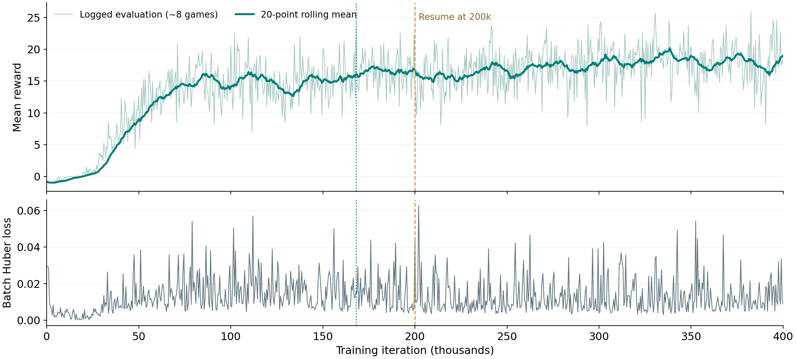
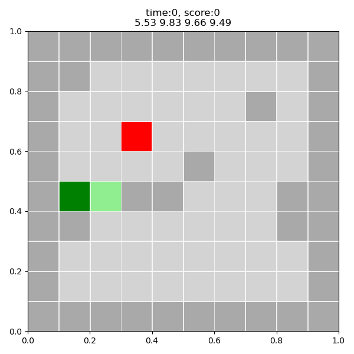

# DTE-2502 Graded Assignment 02 — Snake DQN in PyTorch

This project ports the TensorFlow `DeepQLearningAgent` from
[DragonWarrior15/snake-rl](https://github.com/DragonWarrior15/snake-rl) to PyTorch.
The original Snake environment and NumPy replay buffer are retained with small
compatibility fixes. Model configuration `v17.1` uses a 10 × 10 board, two input
frames, four actions, and obstacles.

## Running Graded Assignment 02

Clone this repository and run commands from its root directory:

```powershell
git clone https://github.com/aotian-zhu/DET2502-ZhuXuanhui.git
cd DET2502-ZhuXuanhui
python -m pip install -r requirements.txt
```

Trained checkpoints are distributed separately through Google Drive; the link
below is pending upload. Place the selected checkpoint at
`models/v17.1/model_168000.pt`. If downloading the model ZIP, extract its contents
into the repository root. The required obstacle library
`models/v17.1/obstacles_board` is already included.

Evaluate the selected checkpoint on CPU:

```powershell
python evaluate.py --iteration 168000 --games 100 --seed 42 --device cpu
```

Generate an animated GIF without FFmpeg:

```powershell
python game_visualization.py --iteration 168000 --device cpu --output images/policy.gif
```

For MP4, install FFmpeg and use an `.mp4` output path. For a static image:

```powershell
python game_visualization.py --iteration 168000 --device cpu --no-animation --output images/policy.png
```

To reproduce the two-stage training procedure, use a separate working copy:
fresh training replaces the existing CSV and writes checkpoints.
`--episodes` specifies the total target iteration, not extra iterations.

```powershell
python training.py --episodes 200000 --device cuda
python training.py --resume-iteration 200000 --episodes 400000 --device cuda
```

Use `--device cpu` without CUDA. Resume requires the first-stage checkpoint and
CSV ending at 200,000, restores model and optimizer states, and refills replay
memory. Replay memory is not saved in the checkpoint.

## Implementation and Code Flow

- `agent.py`: PyTorch CNN, online and target networks, Huber loss, optimization,
  inference, and portable `.pt` checkpoints.
- `training.py`: parallel experience collection, replay sampling, training,
  periodic greedy evaluation, target synchronization, and logging.
- `evaluate.py`: checkpoint evaluation with reward and snake-length metrics.
- `game_visualization.py`: policy rendering.
- `game_environment.py`, `replay_buffer.py`, `utils.py`: original environment,
  replay storage, and rollout helpers with compatibility fixes.
- `model_config/v17.1.json`: network and environment configuration.

The environment returns `(batch, 10, 10, 2)` states. The agent divides board
values by four and converts NHWC to NCHW. Its CNN predicts four Q-values.
Immediate reverse actions are masked during action selection; this mask does
not prevent wall or body collisions. Epsilon-greedy rollouts populate replay
memory. A sampled batch forms the target
`r + gamma * max Q_target(next_state, legal_action)`, omitting the future term
for terminal transitions. The online network minimizes mean Huber loss using
RMSprop, and the target network is periodically synchronized.

## Network and Training Configuration

| Layer | Configuration |
|---|---|
| Input | Two 10 × 10 frames |
| Conv + ReLU | 2 → 16, 3 × 3, same padding |
| Conv + ReLU | 16 → 32, 3 × 3, valid padding |
| Conv + ReLU | 32 → 64, 5 × 5, valid padding |
| Flatten | 1,024 features |
| Linear + ReLU | 1,024 → 64 |
| Linear | 64 → 4 Q-values |

Training uses 128 parallel games, batch size 64, replay capacity 80,000,
discount 0.99, and RMSprop learning rate 0.0005. Target synchronization and
logging occur every 500 iterations. Exploration decays from 1.0 to 0.01.
One iteration collects a step from parallel environments and performs one
optimization update; it is not one complete game.

## PyTorch Migration

Keras layers were replaced with `torch.nn.Module`. Inference uses
`torch.no_grad()`; training uses explicit forward, Huber loss, backward,
gradient clipping, and optimizer steps. Checkpoints store online, target, and
optimizer state dictionaries, with `map_location` for CPU/GPU loading.
Unused TensorFlow agents and supervised-training scripts are excluded.
Compatibility changes include NumPy scalar sampling in obstacle resets and
the animation branch and GIF writer in visualization.

## Results and Reproducibility

Training completed 400,000 iterations in two stages. Training-loop time on an
NVIDIA GeForce RTX 5090 Laptop GPU was 21:08 + 22:07 = 43:15, excluding setup
and separate evaluations. `model_logs/v17.1.csv` contains 800 records at
500-iteration intervals. The default seed is 42; results can vary by hardware
and library version. Training-log evaluations use about eight games and differ
from the larger checkpoint comparisons below.

| Checkpoint | Completed games | Mean reward | Mean snake length |
|---|---:|---:|---:|
| 168,000 (selected) | 100 | 17.89 | 20.89 |
| 382,500 | 100 | 17.79 | 20.79 |
| 400,000 | 101 | 16.00 | 19.00 |

The selected checkpoint was retained among the evaluated candidates because
later candidates did not improve the measured reward. Comparisons use seed 42,
greedy actions, and the same obstacle-board setup; these are not held-out-map
generalization tests. Parallel evaluation can finish more games than requested
on its final step. The recorded policy also exhibits local looping.





## Additional Dependencies

`requirements.txt` lists NumPy, pandas, matplotlib, PyTorch, and tqdm.
TensorFlow and Keras are not required. MP4 rendering additionally requires
FFmpeg; GIF rendering does not. Validation has run in the local environment;
the course GA01 environment has not yet been separately verified.

## Submission Links

- Source repository: https://github.com/aotian-zhu/DET2502-ZhuXuanhui
- Trained model on Google Drive: pending upload and sharing link.
- Presentation video on Google Drive: pending recording, upload, and sharing link.

## Original Project

The environment and original TensorFlow implementation come from
https://github.com/DragonWarrior15/snake-rl. This assignment ports the requested
DQN agent to PyTorch; it does not claim authorship of the upstream environment.
